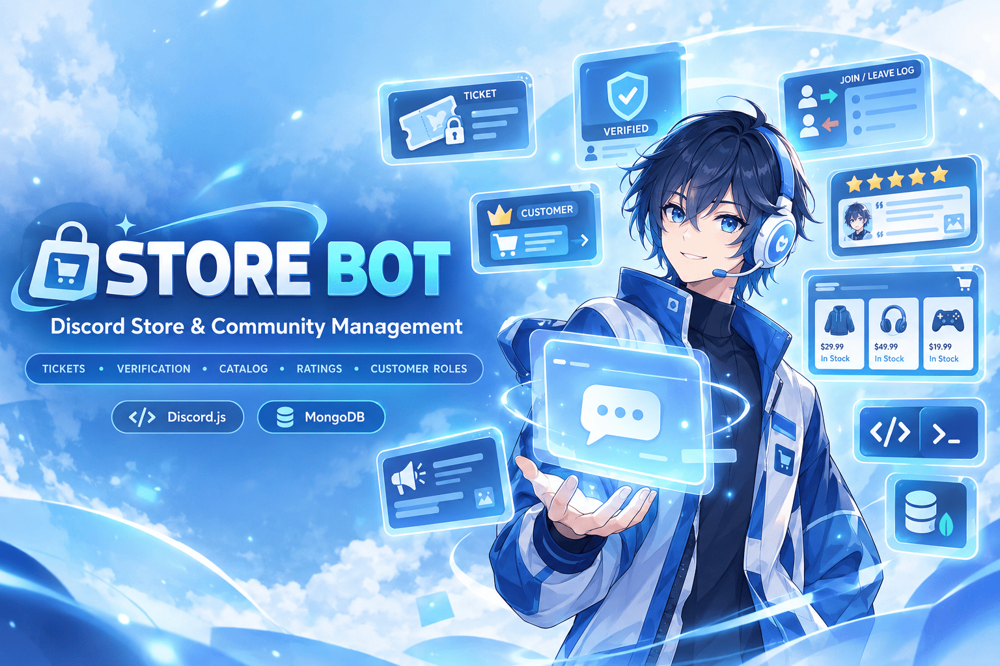

<p align="center">  </p>

# Store Bot

Discord bot for **online stores and selling communities**.
Tickets, verification, join/leave logs, customer roles, testimonials, ratings, a product catalog and announcement posts, with **slash commands**, **prefix commands** and **MongoDB** storage.
Only the official bot token and the official Discord API are used (no self-bots, no user tokens).

Need help or found a bug? Join our Discord server at https://support.namaiki.xyz or report bugs in this code to the email team@namaiki.xyz.

## Table of contents

- [Features](#features)
- [Quick start](#quick-start)
- [Environment variables (.env)](#environment-variables-env)
- [Setting up your store](#setting-up-your-store)
- [Commands](#commands)
- [Prefix commands](#prefix-commands)
- [Feature guides](#feature-guides)
  - [Ticket system](#ticket-system)
  - [Verification](#verification)
  - [Join / leave log](#join--leave-log)
  - [Customer role](#customer-role)
  - [Testimonials](#testimonials)
  - [Ratings](#ratings)
  - [Product catalog](#product-catalog)
  - [Posting announcements](#posting-announcements)
- [Permissions](#permissions)
- [Troubleshooting](#troubleshooting)
- [Project structure](#project-structure)
- [Discord Terms of Service / Developer Policy](#discord-terms-of-service--developer-policy)
- [Security](#security)
- [License](#license)

---

## Features

- **Ticket system:** a panel with an *Open Ticket* button, private ticket channels, claim, add/remove members, close with reason, HTML transcripts (sent to a log channel and to the customer by DM).
- **Verification:** one-click button or captcha, with a verified role and an optional unverified role that is given on join.
- **Join / leave log:** rich embeds with account age, member count, join date and roles.
- **Customer role:** give the customer role after a sale, track purchases per customer, announce new purchases and see the top customers.
- **Testimonials:** customers post a review with an optional proof screenshot, shown in a testimonial channel.
- **Rating:** `/rate` for the store or a product, an automatic star-rating request by DM when a ticket closes, and an average score with a star breakdown.
- **Product catalog:** products with price, stock, category and image, a paged catalog with a select menu, and a one-click *Order Now* button that opens a ticket for that product.
- **Post command:** send announcement embeds to any channel with an optional title, color and image.
- **Prefix commands:** every command also works with a prefix (default `!`).
- **Clean help menu:** `/help` groups all commands into sections with a select menu.
- **Automatic slash command sync** on every start.

---

## Quick start

You need **Node.js 18 or newer**.

### 1. Create the bot

1. Go to the [Discord Developer Portal](https://discord.com/developers/applications) and click **New Application**.
2. **General Information** tab: copy the **Application ID** (this is your `CLIENT_ID`).
3. **Bot** tab:
   - Click **Reset Token** and copy the token (this is your `DISCORD_TOKEN`).
   - Under **Privileged Gateway Intents**, enable **Server Members Intent** (join/leave log and unverified role) and **Message Content Intent** (prefix commands and ticket transcripts). The bot cannot log in without them.

### 2. Create a MongoDB database

1. Create a free cluster at [MongoDB Atlas](https://www.mongodb.com/atlas).
2. Create a **database user** (username + password).
3. In **Network Access**, allow the IP address of the machine that runs the bot.
4. Click **Connect -> Drivers** and copy the connection string (this is your `MONGO_URI`). Replace `<password>` with your user's password.

Use your own database. Never use a connection string that someone else shared with you.

### 3. Configure `.env`

Copy `.env.example` to `.env` and fill it in. See [Environment variables](#environment-variables-env) for what each value means.

```bash
cp .env.example .env
```

### 4. Install and start

```bash
npm install
npm run deploy     # registers the slash commands (optional, see note below)
npm start
```

Slash commands are also synced automatically on every start (turn it off with `AUTO_DEPLOY=false`), so `npm run deploy` is only needed if you want to register them without starting the bot.

### 5. Invite the bot

Replace `YOUR_CLIENT_ID` with your Application ID:

```
https://discord.com/oauth2/authorize?client_id=YOUR_CLIENT_ID&scope=bot+applications.commands&permissions=268561488
```

The link asks for: Manage Roles, Manage Channels, View Channels, Send Messages, Manage Messages, Embed Links, Attach Files, Read Message History and Add Reactions.

Place the bot's role **above** the verified, unverified and customer roles, otherwise it cannot give them.

---

## Environment variables (.env)

| Variable | Required | Description |
| --- | --- | --- |
| `DISCORD_TOKEN` | yes | Bot token (Developer Portal -> Bot -> Reset Token). |
| `CLIENT_ID` | yes | Application ID (Developer Portal -> General Information). |
| `MONGO_URI` | yes | Your MongoDB connection string. |
| `GUILD_ID` | no | If set, slash commands are registered only for this server and update instantly. If empty, they are registered globally (can take up to an hour to appear). |
| `AUTO_DEPLOY` | no | `true` (default) syncs slash commands on every start. Set `false` to disable. |
| `STORE_NAME` | no | Default store name shown on embeds. Can be changed in Discord with `/setup store`. |
| `DEFAULT_STATUS` | no | Bot status text, shown as "Watching ...". |
| `PREFIX` | no | Prefix for text commands. Default `!`. Use commas for several prefixes, e.g. `!,?`. |

---

## Setting up your store

Run these as a server admin (**Manage Server** permission). Each step is optional, so only set up what you use.

1. **Store details:** `/setup store name:My Shop currency:Rp`
2. **Tickets:** create a category and a staff role, then `/setup ticket category:#Tickets staff-role:@Staff transcript-channel:#ticket-logs`
3. **Verification:** `/setup verification verified-role:@Verified unverified-role:@Unverified mode:Button`
4. **Join/leave log:** `/setup joinleave channel:#join-leave`
5. **Customer role:** `/setup customer role:@Customer log-channel:#new-customers`
6. **Testimonials:** `/setup testimonial channel:#testimonials`
7. **Ratings:** `/setup rating channel:#ratings`
8. **Add products:** `/product add name:Netflix Premium price:25000 stock:10 category:Streaming`
9. **Post the panels:** `/panel ticket`, `/panel verify` and `/panel catalog` in the channels you want.
10. Check everything with `/setup view`.

---

## Commands

Commands marked **Admin** need the **Manage Server** permission. Commands marked **Staff** need the staff role (set in `/setup ticket`) or **Manage Server**.

### Shopping (everyone)

| Command | Description |
| --- | --- |
| `/catalog [category]` | Browse the product catalog and order. |
| `/rate stars [comment] [product]` | Rate the store or one product (once per 24 hours per target). |
| `/ratings [product]` | Show the average rating and the star breakdown. |
| `/testimonial submit product message [image]` | Post a testimonial (customers only by default). |
| `/ticket close [reason]` | Close the ticket you are in (ticket owner or staff). |
| `/help [section]` | Show all commands, grouped by section. |

### Staff

| Command | Description |
| --- | --- |
| `/ticket claim` | Claim the current ticket. |
| `/ticket add user` | Add a member to the current ticket. |
| `/ticket remove user` | Remove a member from the current ticket. |
| `/ticket rename name` | Rename the current ticket channel. |
| `/customer add user [product] [note]` | Give the customer role, count the purchase and lower the product stock by 1. |
| `/customer remove user` | Remove the customer role. |
| `/customer info user` | Show the purchase summary of a member. |
| `/customer top` | Show the top 10 customers. |
| `/testimonial delete number` | Delete a testimonial. |
| `/post channel message [title] [color] [image]` | Post an announcement embed in a channel. |

### Admin

| Command | Description |
| --- | --- |
| `/setup ticket` | Ticket category, staff role, transcript channel, max open tickets per member. |
| `/setup verification` | Verified role, unverified role and mode (button or captcha). |
| `/setup joinleave` | Join/leave log channel. |
| `/setup customer` | Customer role and optional announcement channel. |
| `/setup testimonial` | Testimonial channel and customers-only switch. |
| `/setup rating` | Rating channel. |
| `/setup store` | Store name and currency. |
| `/setup view` | Show the current configuration. |
| `/panel ticket` / `verify` / `catalog` | Post a panel in a channel (custom title, text, color and banner are optional). |
| `/product add` | Add a product (name, price, description, category, stock, image link). |
| `/product edit` | Edit a product. |
| `/product stock` | Set the stock (`-1` means unlimited). |
| `/product remove` | Remove a product. |
| `/product info` / `list` | Show one product or all products. |

---

## Prefix commands

Every command also works as a text command. The default prefix is `!` (change it with `PREFIX` in `.env`).

```
!catalog
!rate 5 Fast and friendly service
!ticket close Order completed
!customer add @Buyer "Netflix Premium"
!product add "Netflix Premium" 25000 "Family plan" Streaming 10
!post #announcements color:#ff0000 title:"Big sale" Everything is 20% off today!
```

How values are read:

- Values are filled in the same order as the slash options. `<value>` is required and `[value]` is optional (see `!help`).
- Put **"quotes"** around a value that has spaces. The last text value can contain spaces without quotes.
- You can give any value **by name**: `color:#ff0000`, `title:"My title"`.
- For image options, **attach the file** to your message.
- Mentions (`@user`, `#channel`, `@role`) and IDs both work.
- Admin and staff checks are the same as for slash commands.

Replies to prefix commands are visible to everyone in the channel (text commands cannot be private), so use slash commands for sensitive things such as `/setup view`.

---

## Feature guides

### Ticket system

1. An admin runs `/setup ticket` and `/panel ticket`.
2. A member presses **Open Ticket**, fills in what they need, and a private channel `ticket-0001-name` is created. Only the member, the staff role and the bot can see it.
3. Staff press **Claim** (or `/ticket claim`) so everyone knows who is helping.
4. Staff or the owner press **Close Ticket** (or use `/ticket close`). The channel is deleted after 5 seconds.
5. On close, an **HTML transcript** is sent to the transcript channel and to the member by DM, followed by a **star-rating request** (see [Ratings](#ratings)).

Members can have `max-tickets` open tickets at the same time (default 1). If a ticket channel is deleted by hand, the ticket is closed automatically.

### Verification

Run `/setup verification` and `/panel verify`. Members press **Verify**:

- **Button mode:** the member gets the verified role right away.
- **Captcha mode:** the bot shows a 5-character code, the member types it in a pop-up. The code expires after 2 minutes and allows 3 attempts.

If you set an **unverified role**, it is given to every new member on join and removed when they verify. Hide your store channels from that role (or from `@everyone`) and show them to the verified role.

### Join / leave log

Set a channel with `/setup joinleave`. The bot posts:

- **Join:** the member, account creation date, member count, user ID and a warning for accounts younger than 7 days.
- **Leave:** the member, join date, member count, user ID and the roles they had.

### Customer role

After a sale, staff run `/customer add user:@Buyer product:Netflix Premium`. The bot:

- gives the customer role,
- counts the purchase for that customer,
- lowers the stock of that product by 1 (if it has limited stock),
- announces the purchase in the customer log channel (if set).

Use `/customer info` for one customer and `/customer top` for the best customers. With `/setup testimonial customers-only:true` (the default), only members with the customer role can post testimonials.

### Testimonials

Customers run `/testimonial submit product:... message:... image:...`. The bot posts a clean embed in the testimonial channel, copies the proof image so it never expires, and adds a 💛 reaction. There is a 10 minute cooldown per member. Staff can remove a testimonial with `/testimonial delete number:` (the number is shown in its footer).

### Ratings

- **Command:** `/rate stars:5 comment:Fast and friendly! product:Netflix Premium` posts the rating in the rating channel. One rating per member per target (store or product) every 24 hours.
- **After a ticket:** when a ticket is closed, the member gets a DM with five star buttons and an optional comment. One rating per ticket.
- **Averages:** `/ratings` shows the average score and a bar chart of all stars, for the whole store or one product.

### Product catalog

- Add products with `/product add`. **Stock** can be a number or left empty for unlimited. Use a **permanent image link** (for example from Imgur) in `image-url`, because Discord attachment links expire.
- `/catalog` (or the **View Catalog** button of `/panel catalog`) shows 5 products per page with a select menu. Choosing a product shows its details with an **Order Now** button.
- **Order Now** opens a ticket for that product. Products with 0 stock cannot be ordered.
- Only you see your own catalog view, so many people can browse at the same time.

### Posting announcements

Staff can post as the bot: `/post channel:#news message:Big sale today! title:Sale color:#ff0000 image:(upload)`.

- `color` is a hex code (default is the bot's blue). `image` can be an upload or an `image-url` link.
- Write `\n` in the message for a new line.
- Uploaded images are re-uploaded by the bot, so they do not expire.
- You can only post in channels where you can send messages yourself (admins can post anywhere the bot can).

---

## Permissions

The bot needs these server permissions: Manage Roles, Manage Channels, View Channels, Send Messages, Manage Messages, Embed Links, Attach Files, Read Message History and Add Reactions.

- The bot's role must be **above** the verified, unverified and customer roles.
- In the ticket category, the bot needs permission to create channels (Manage Channels).
- In every log, testimonial and rating channel, the bot needs **View Channel**, **Send Messages** and **Embed Links**.

---

## Troubleshooting

- **Prefix commands do nothing:** enable the **Message Content Intent**, check the `PREFIX` value and make sure the bot can read and send messages in that channel.
- **Slash commands do not show up:** set `GUILD_ID` for instant updates, or wait up to an hour for global commands. Make sure the invite link contains `applications.commands`.
- **"Used disallowed intents" when starting:** enable **Server Members Intent** and **Message Content Intent** in the Developer Portal -> Bot.
- **"I could not give you the role":** move the bot's role above the verified/customer role in Server Settings -> Roles.
- **"I could not create the ticket channel":** give the bot **Manage Channels** and **Manage Roles**, and run `/setup ticket` again.
- **Transcripts look empty:** the Message Content Intent is off.
- **No rating DM after closing a ticket:** the member has direct messages from server members turned off.
- **`MONGO_URI is missing` or a connection timeout:** check the connection string and the Network Access list in MongoDB Atlas.
- **`E11000 duplicate key error ... index: id_1` when adding a product:** the database you connected to already has an old unique index from another project. Use your own, empty database (put a new database name in `MONGO_URI`, for example `/storebot` before the `?`), or delete the `id_1` index of the `products` collection in MongoDB Atlas.
- **`Interaction expired before the bot could answer` in the console:** Discord only waits 3 seconds for a reply. This happens when the host restarts, reconnects or lags, and commands used while the bot was offline arrive late. It is harmless: the member just runs the command again. If it happens often, the problem is the host (see below).
- **The bot restarts or goes offline again and again:** this comes from the hosting panel, not from the bot. Free hosts can drop the panel connection and re-run the start command, and `npm install` runs on every start, so the bot can be offline for a few minutes each time. Set `AUTO_DEPLOY=false` in `.env` after the first start (run `npm run deploy` only when commands change), and move to a more stable host or a VPS if it keeps happening.

---

## Project structure

```
src/
  index.js            entry point
  config.js           environment based configuration
  commands/           one file per command (setup, panel, post, ticket, product, catalog, customer, testimonial, rate, ratings, help)
  core/               prefix command parser (turns text commands into the same code path as slash commands)
  database/           MongoDB connection and models (GuildConfig, Product, Ticket, Customer, Testimonial, Rating)
  events/             Discord event handlers (ready, interactionCreate, messageCreate, guildMemberAdd/Remove, channelDelete)
  handlers/           command and event loaders
  scripts/            deploy-commands.js (npm run deploy)
  services/           tickets, verification, catalog, ratings, help, slash command sync, guild config
  utils/              banner, embeds, formatting, permissions and transcript helpers
```

---

## Discord Terms of Service / Developer Policy

- Official bot account and token only. No self-bots, no scraping, no automation of user accounts.
- Server Members Intent and Message Content Intent are privileged intents. For bots in fewer than 100 servers they are enabled with a single toggle.
- The bot stores: server settings, product data, ticket records (user IDs, usernames, subject, timestamps), customer purchase counts, testimonials and ratings. Ticket transcripts are generated on close and sent to your log channel and the customer; they are not kept in the database.
  Tell your members that this data is stored, and delete it on request by removing the documents in MongoDB.
- The bot only sends DMs to members who opened a ticket (transcript and rating request). It does not send mass messages.

---

## Security

- Never commit `.env`. Never paste tokens, connection strings or cookies into chats or public repositories.
- If a token or password was ever shared publicly, rotate it immediately (Developer Portal -> Bot -> Reset Token, and change the MongoDB user password).

---

## License

Released under the **APRILIOV Use-Only License** - Copyright (c) 2026 APRILIOV. All rights reserved. See the [LICENSE](LICENSE) file for the full terms.

- **Allowed:** use the bot and configure it through its settings (`.env` and the in-app commands).
- **Not allowed:** modifying the code, selling or renting it (or access to it), and sharing or redistributing it.
- The copyright and license notice must stay intact.

The software is provided "as is", without warranty of any kind. The license notice is also shown in the console every time the bot starts.
